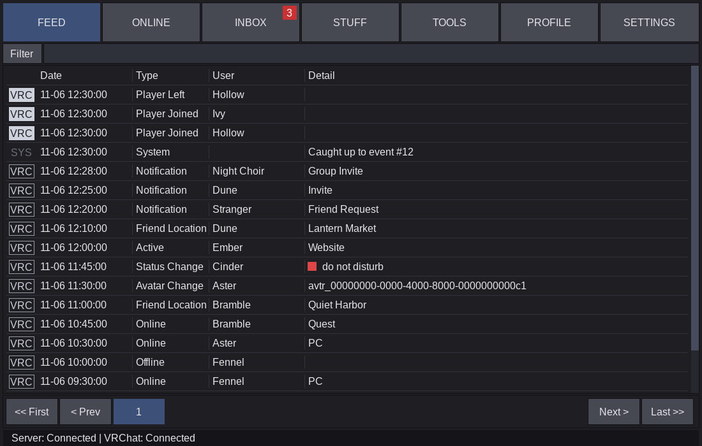
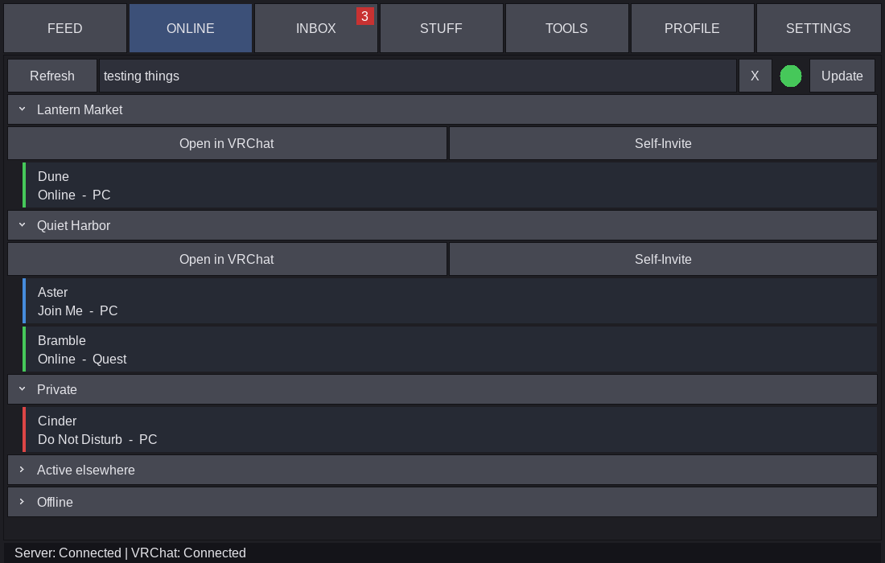
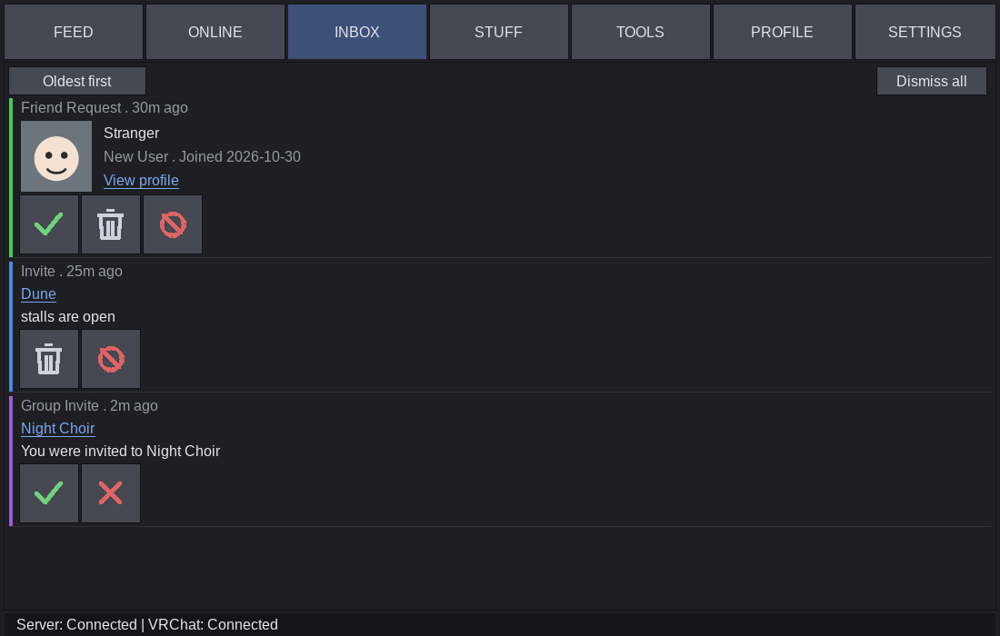
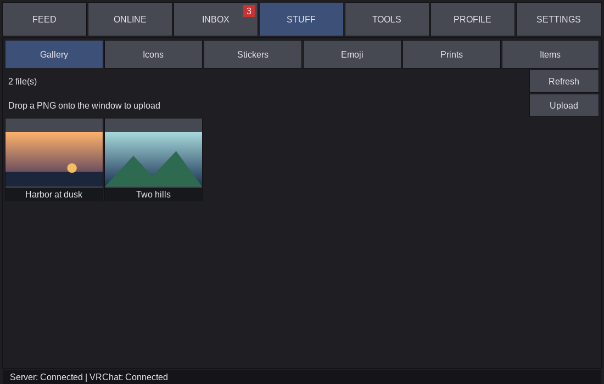
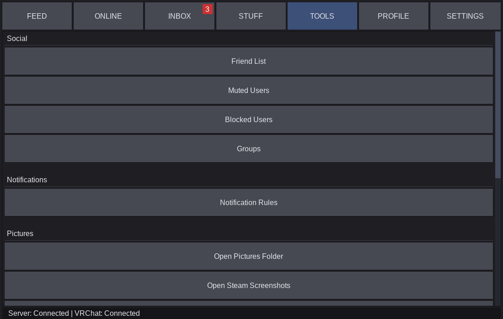
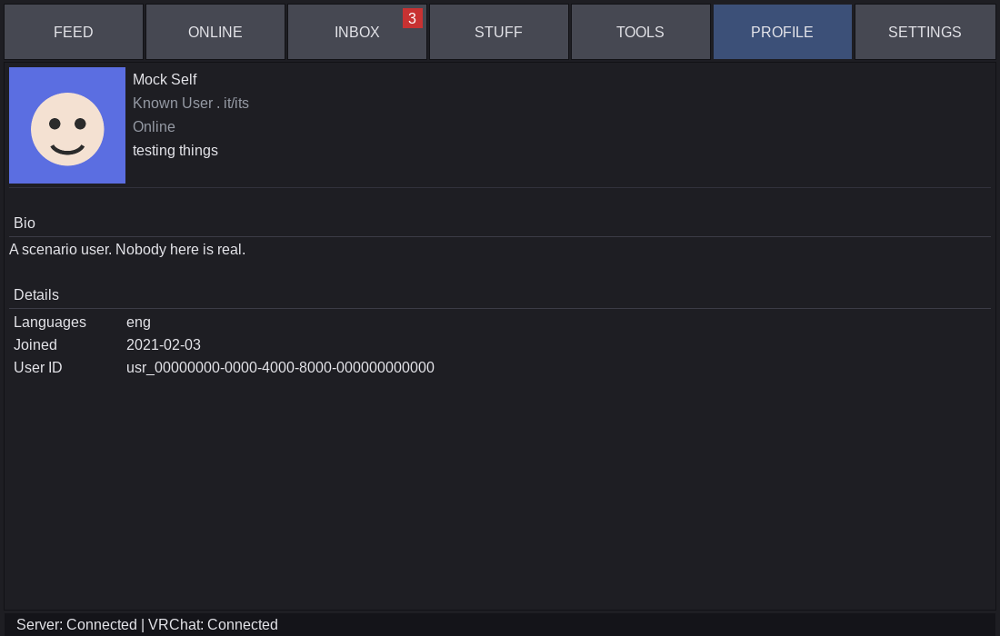
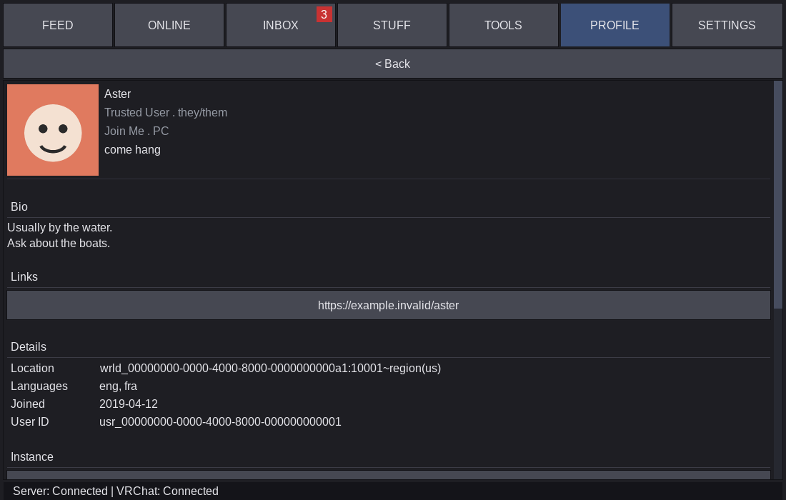
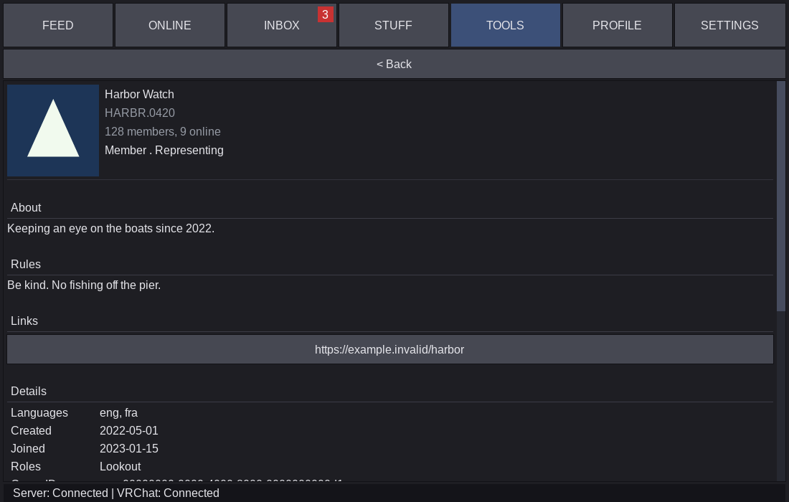
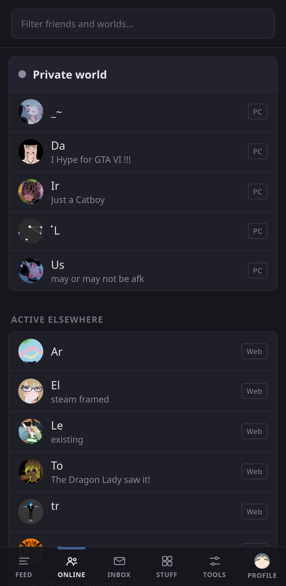

#  vrcd

A little companion suite for VRChat to help you track friend activity,
inject metadata into photos, and receive VR/desktop notifications.

It features a server-client architecture, to avoid having multiple connections to VRC APIs.

> [!WARNING]
> Status: Most features present. Stable for daily use; Under active development.
> 
> Otherwise, get ready to frequently pull, upgrade dependencies, and build!

Client features:
- Relatively light client using software rendering; Hardware option available.
- VR friendly UI.
- Embed world and player metadata into VRChat photos automatically.
- Strip VRChat and other metadata from VRChat photos.
- VR overlay notifications (XSOverlay/WayVR, OVR Toolkit) and desktop notifications.
- [Drop a Portal](https://dropaport.al/) integration.
- Working "Show in VRChat" button in Linux.

Server features:
- Record incoming VRChat events.
- Event-stream API with 'catch-up' and 'back-fill' actions to know what you missed.

Feel free to join the official [VRCD VRChat group](https://vrc.group/VRCD.7796) (`VRCD.7796`)!

Related projects:
- [vrcd-server-container](https://github.com/ArcaneDisgea/vrcd-server-container) by ArcaneDisgea.

## Client Screenshots

Taken from the mock scenario (see [Mocking and Screenshots](#mocking-and-screenshots)).

### Feed Page



### Online Page



### Inbox



### Stuff



### Tools



### Profile



### Friend Profile



### Group



## Web Screenshots



## Installing

See [Compiling](#compiling).

After connecting to the server, the authentication will be forward to the
first connected client. After connecting, you should be good to go!

### Linux: pipehelper

The pipehelper subpackage is used to make "Open in VRChat" button work.

To make it work, you need a Windows build of it.

- From Linux, `pipehelper/build.sh` cross-builds
  `pipehelper/vrcd-pipehelper.exe` with LDC and lld-link (no Windows SDK needed).
- On Windows, `dub build :pipehelper` does the same.

Then build the client: it embeds `pipehelper/vrcd-pipehelper.exe` when the
file exists, and writes it to `~/.config/vrcd` when first needed. A copy placed
next to the `vrcd_client` executable takes precedence.

No Steam launch options are needed: the client runs the helper with the Proton
build VRChat itself is running under, against the game's prefix, which attaches
it to the wineserver holding the launch pipe.

If the helper is missing, or the IPC attempt fails, the client falls back
to a server-side self-invite.

### Linux: AArch64

An AArch64 AppImage is built alongside the x86_64 one. It is untested.
VRChat runs there as x86_64 Proton under an emulator like FEX. Known caveats:

- "Open in VRChat" finds Proton's wine through `/proc/<pid>/exe` of the game
  process. Under FEX that is likely the FEX interpreter, in which case the
  client falls back to a self-invite.
- Log and Pictures folders come from the Steam library layout
  (`steamapps/compatdata/438100`), assumed unchanged.

# For Developers

## Architecture

```text
             + ~ ~ ~ ~ ~ ~ ~ ~+
             | VRChat servers |
             +~ ~ ~ ~ ~ ~ ~ ~ +
                      ^
          HTTP requests / WS events
                      v
             +----------------+
             | vrcd-server    |
             | - VRC API sync |
             | - Friend state |
             +----------------+
                      ^
                    JSON-L
                      v
          +-----------+-----------+
          v                       v
+-----------------+      +----------------+                +----------+
| vrcd-client(s)  |      | vrcd-web       | <- HTTP/WS ->  | Browser  |
| - Picture meta  |      | - Serves HTML  |                | - Notifs |
| - Notifications |      | - Same link    |                | - etc. ! |
+-----------------+      +----------------+                +----------+
```

Targets:
- **[Server](server/)**: Stays connected to VRChat's WebSocket 24/7, records events to SQLite, and serves them over TCP.
- **[Client](client/)**: Connects to the server, watches local VRChat logs, and injects metadata into photos.
- **[Web](web/)**: Connects to the server, and allows you to browse vrcd using a Web browser.

Targets Windows and Linux.

## Compiling

Needs a D compiler with front-end version 2.104 (DMD >=2.104, GDC >=14, LDC >=1.34).

See each component's README for dependencies, configuration, and architecture details.

In short:
- Client needs SDL3 libraries (SDL3, SDL3_ttf, SDL3_image), and optionally OpenSSL. They are loaded at run time by default, and only needed at build time with `dub build :client -c static`.
- Server needs the sqlite library, and optionally OpenSSL. libcurl is loaded at run time by default, and only needed at build time with `dub build :server -c static`.

```bash
# Upgrade dependencies for server and client
dub upgrade -s

# Build, test, and run server (might be best to setup config first)
# For more info, see server/README.md
dub test :server
dub build :server
# Will live at ./server/vrcd_server

# Build, test, and run client
# For more info, see client/README.md
dub test :client
dub build :client
# Lives at ./client/vrcd_client

# Ditto
dub test :web
dub build :web
# Lives at ./web/vrcd_web
```

See [API.md](./API.md) for server-client API details.

### Mocking and Screenshots

The server can serve a fixed scenario instead of VRChat, so the front-ends can
be worked on without a VRChat session, and the same screenshot comes out twice.
The database is in memory and nothing is sent to VRChat: anything that would
change something there answers "Read-only in mock".

```bash
# Every client page as a PNG under ./screenshots/ (builds first, -n skips that)
tools/screenshots.sh
# Only some pages, named or not
tools/screenshots.sh feed inbox=notifications tools:groupList
# Refresh the README pictures
tools/screenshots.sh -o packaging/flatpak/screenshots 1-main=feed 2-online=online \
    3-inbox=notifications 4-stuff=inventory:gallery 5-tools=tools 6-profile=profile \
    7-user=user:usr_00000000-0000-4000-8000-000000000001 \
    8-group=group:grp_00000000-0000-4000-8000-0000000000d1

# Click around in a real window, settings are left alone
client/vrcd_client --mock server/mock/basic.json --log-replay server/mock/basic_log.txt

# The server on its own, listening as configured, for other front-ends
server/vrcd_server --mock server/mock/basic.json
```

Client options for this:
- `--mock FILE`: run the embedded server on a scenario. Default settings, none
  saved, pictures kept out of the disk cache, and the clock frozen at the
  scenario's `now`.
- `--log-replay FILE`: read a VRChat log as new lines once caught up, instead
  of watching the real ones.
- `--page TARGET`: open on a tab (`feed`, `online`, `notifications`,
  `inventory`, `tools`, `profile`, `settings`), a sub-page
  (`inventory:prints`, `tools:muteList`), `user:ID` or `group:ID`.
- `--screenshot FILE.png`, `--size WxH`, `--screenshot-delay MS`: save one
  frame once caught up, then quit. The window is hidden and drawn at scale 1.

Times are drawn in the local time zone, so set `TZ=UTC` for repeatable
pictures (the script does).

The scenario is [server/mock/basic.json](server/mock/basic.json), and its keys
are described at the top of
[server/source/server/mock.d](server/source/server/mock.d). In short: VRChat's
own shapes for `self`, `friends`, `users`, `notifications`, `groups`,
`moderations`, `files`, `prints` and `inventory`, plus `events` at offsets from
`now` (`"at": "-5m"` is history, `"+10s"` arrives live). Pictures are
`server/mock/images/<file id>.png`, linked from the data by VRChat image URLs.

### Packaging

```bash
./packaging/package-appimage.sh   # client AppImage, with the server (client builds with -c static), host arch
./packaging/package-deb.sh all    # client and server .deb
./packaging/package-deb.sh --static server # Package server as static build
```

On Windows, in PowerShell (no MSYS2 or Git Bash needed):

```powershell
powershell -executionpolicy bypass packaging/fetch-deps-windows.ps1   # Fetches SDL3, libcurl, builds sqlite3
powershell -executionpolicy bypass packaging/package-windows.ps1      # Zips client and server
```

The first script downloads the DLLs the two binaries load at run time, since
Windows ships none of them, and compiles the sqlite3 amalgamation into
`sqlite3.lib` for the server to link against. That last step is the only one
needing Visual Studio Build Tools with the C++ workload; it finds them itself
through `vswhere`, so a plain PowerShell prompt is enough.

`sqlite3.lib` is dropped in the repository root, not under `packaging/deps/`,
because that is where the linker looks: `pragma(lib, "sqlite3")` becomes
`/DEFAULTLIB:sqlite3`, and after `/LIBPATH` and `LIB` the linker falls back to
the working directory, which is wherever `dub` was invoked. Having run the fetch
script once, a plain `dub build :server` from the root works too.

The zips are self-contained: the client carries SDL3, SDL3_ttf and SDL3_image,
and the server carries libcurl (`sqlite3` is linked in). The client zip also
carries the server and its libcurl, for "Use local server". libcurl comes from
curl.se and is built against the Windows certificate store, so no CA bundle is
shipped with it. The pipe helper is not in the client zip, because talking to
VRChat's launch pipe is in-process on Windows.

### Issues

- Using LDC 1.41 on Windows will lead to compiling issues: undefined PAGESIZE in core.thread.fiber

# Contributing

I'm unsure how I want to handle contributions at this moment, sorry.

However, feel free to submit bugs in Issues and feature suggestions in Discussions, thanks.
It is apprciated.

# Disclaimer

This software is provided as-is without any warranty and is not affiliated with VRChat.

VRCD does not modify the game client in any shape, nor does it reflect the views
or opinions of VRChat. It is only an external tool using the VRChat API.

Users are still responsible for complying with VRChat's Terms of Service.

VRChat is copyrighted work of VRChat Inc.

# License

Both the server and client components are licensed BSD-3-Clause-Clear.
